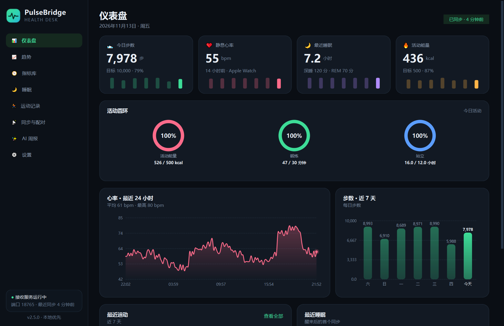
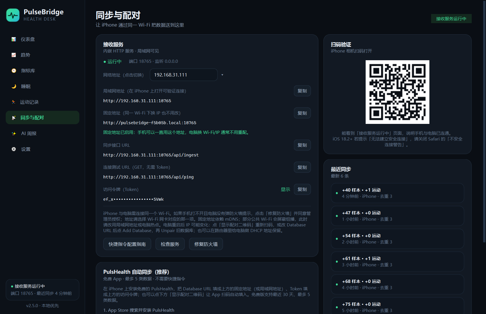
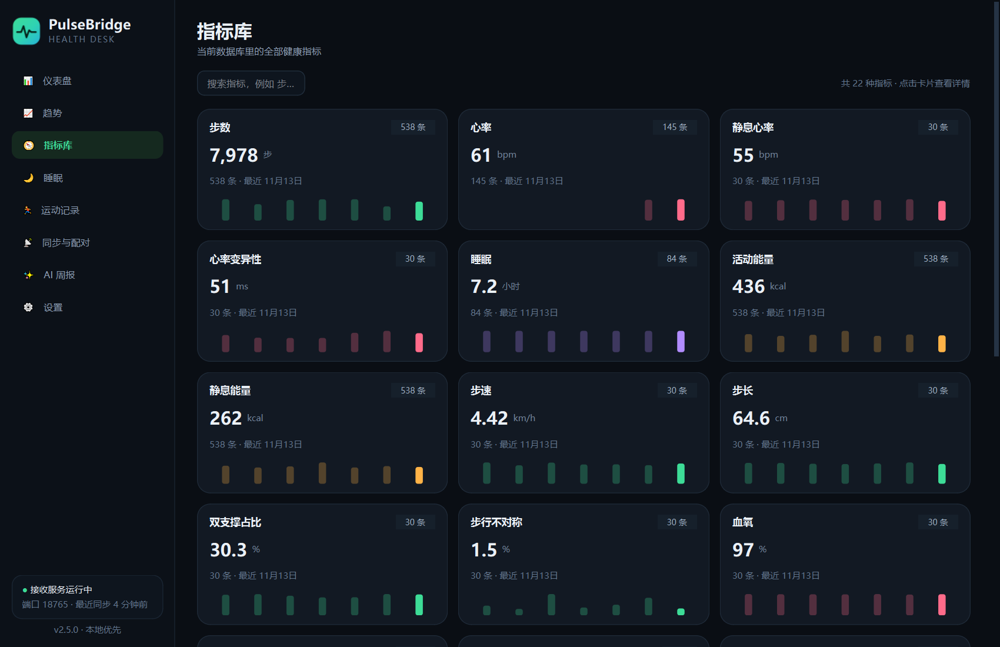
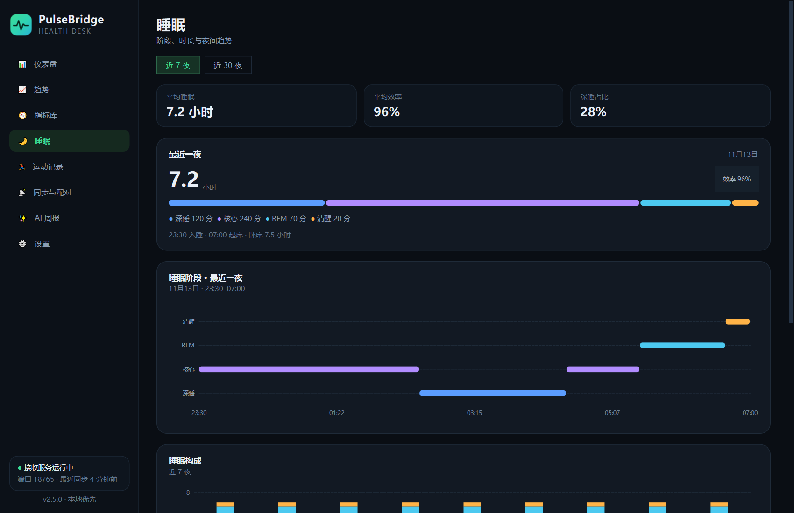
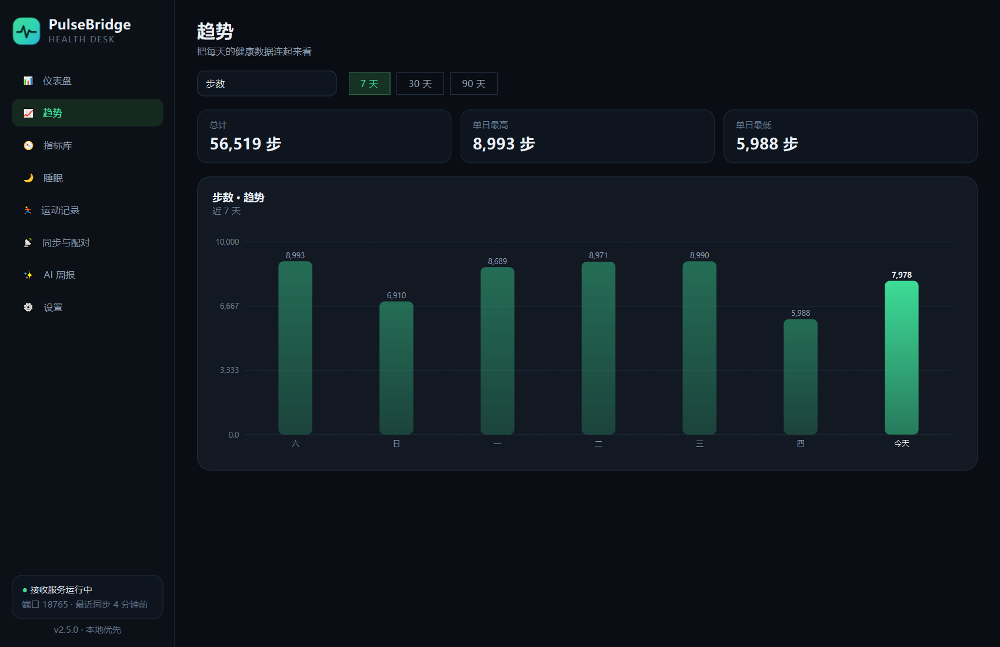
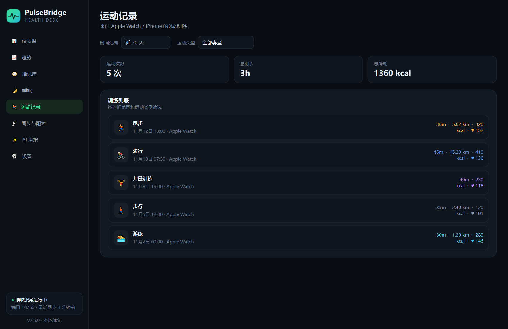
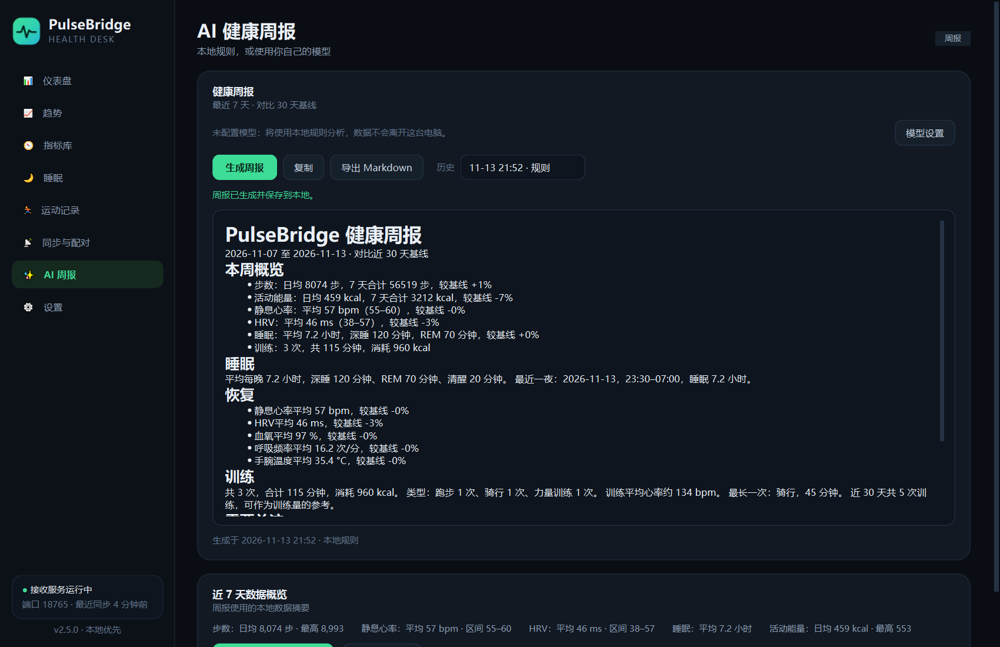
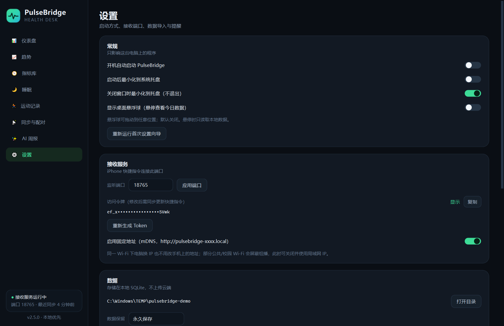
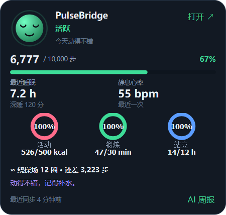
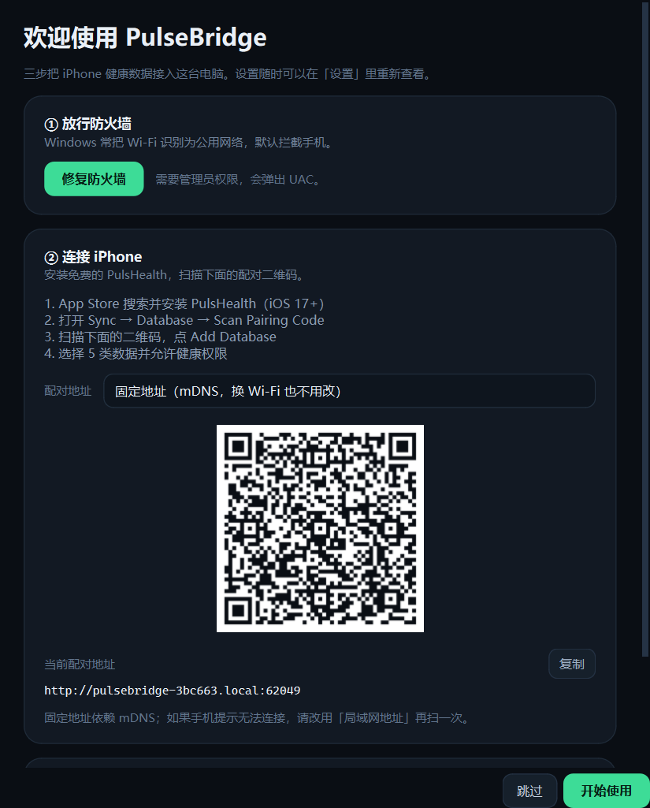

# PulseBridge

**本地优先的 Apple 健康数据看板（Windows 桌面端）。**

PulseBridge 让你的 iPhone / Apple Watch 健康与运动数据自动出现在 Windows 上：
电脑端内置一个局域网接收服务；iPhone 端既可以用**免费的 PulsHealth App 自动后台同步**，
也可以用 iOS 自带的「快捷指令」手动搭建。数据归一化后存入本地 SQLite，
并用一个精致的深色仪表盘展示。

- **完全免费**：PulsHealth 免费版即可自动同步 5 类数据；也支持纯系统快捷指令，无需付费 App。
- **本地优先**：数据只存在你的电脑上，不上传云端，不注册账号。
- **指标库**：自动展示数据库中的全部指标（Apple 导出可达 40+ 种），支持搜索与趋势跳转。
- **活动圆环与睡眠详情**：Move / Exercise / Stand 圆环、睡眠阶段时间轴、夜间趋势。
- **锻炼分钟估算**：没有官方 Exercise Time 时，按心率储备（ACSM）、步频（100/130 步/分）
  和活动能量 MET（WHO）逐分钟估算，界面显示 `≈`。
  说明见 [docs/exercise-estimate.md](docs/exercise-estimate.md)。
- **桌面悬浮球（可选）**：悬停查看今日步数、睡眠、静息心率和活动圆环；
  自带步数换算、连续达标、动态表情和随机小贴士，可拖动到任意位置。
- **开箱即用**：单个桌面程序，内置接收服务、托盘常驻、开机自启、二维码配对。
- **首次设置向导**：防火墙、PulsHealth 配对二维码、导入入口一步步完成。
- **安装包与更新检查**：Windows 安装包按用户安装；启动时每天检查一次新版本。
- **固定地址**：mDNS 广播 `http://pulsebridge-xxxx.local:8765`，同一 Wi-Fi 下电脑换 IP
  通常不需要重新配对手机。
- **为 AI 打底**：结构化存储 + 一键导出 JSON，后续可接入大模型做健康分析。

<p align="center">
  
  
</p>

<p align="center">
  
  
</p>

<p align="center">
  
  
</p>

<p align="center">
  
  
</p>

<p align="center">
  
</p>

<p align="center">
  
</p>

---

## 数据流

```
 Apple Watch / iPhone 健康 App
            │  HealthKit
            ▼
 ┌──────────────────────────────┐
 │ iPhone 端（三选一/可组合）     │
 │ ① PulsHealth（免费，自动同步）│── POST /v1/batches (gzip NDJSON) ─┐
 │ ② iOS 快捷指令（系统自带）    │── POST /api/ingest (JSON) ─────────┤
 │ ③ Apple Health 导出 zip        │── 设置 → 导入（全量历史）──────────┤
 └──────────────────────────────┘                                   │
                                                                     ▼
 ┌─────────────────────────────────────────────────────────────────────┐
 │  PulseBridge（Windows 桌面端）                                      │
 │  ├─ 内置 HTTP 接收服务 :8765（Bearer/Token 鉴权）                    │
 │  ├─ 归一化 + 按 UUID 去重 + SQLite                                   │
 │  └─ PySide6 仪表盘 / 系统托盘                                       │
 └─────────────────────────────────────────────────────────────────────┘
```

> **为什么不能直连？** Apple HealthKit 没有公开的云端 API，任何 Windows 程序都无法
> 直接读取 iPhone 的健康数据库。必须由手机侧 App 主动导出：推荐免费的
> **PulsHealth**（自动同步、无需搭建），或使用系统自带的快捷指令（无需装 App）。

## 功能

- **仪表盘**：今日步数、静息心率、最近睡眠、活动能量；活动圆环；24 小时心率、7 天步数、
  睡眠阶段分布、最近运动。
- **指标库**：全部已入库指标的最新值、样本量、7 天迷你趋势，支持搜索与趋势跳转。
- **睡眠详情**：阶段时间轴（Hypnogram）、7/30 夜构成、手腕温度、呼吸紊乱、睡眠目标。
- **趋势**：9 种指标的 7 / 30 / 90 天趋势，自动区分「按日累计」与「按日平均」。
- **运动记录**：跑步、骑行、力量训练等，含时长、距离、消耗、平均心率。
- **同步与配对**：局域网地址、Token、二维码、最近同步日志、已接收指标统计。
- **内置 PulsHealth 接收协议**：免费 App 自动后台同步 5 类数据，零快捷指令配置。
- **Apple Health 全量导入**：导入 `export.zip` 获取全部指标与历史，支持每周/每月提醒。
- **系统托盘**：关闭窗口不退出，后台持续接收；可设置开机自启。
- **AI 健康周报**：默认本地规则分析；也可配置自己的 OpenAI 兼容 API（GLM / DeepSeek 等）
  或本地 Ollama，只发送 7/30 天聚合统计。

## 支持的数据

| 快捷指令类型 | 归一化类型 | 用途 |
| --- | --- | --- |
| 心率 | `heart_rate` | 24 小时曲线、日平均 |
| 静息心率 | `resting_heart_rate` | 恢复状态 |
| 心率变异性 | `hrv` | 压力 / 恢复 |
| 步数 | `steps` | 每日步数与目标 |
| 活动能量 | `active_energy` | 每日消耗与目标 |
| 睡眠 | `sleep_analysis` | 深睡 / 核心 / REM / 清醒 |
| 血氧 | `oxygen_saturation` | 趋势 |
| 呼吸频率 | `respiratory_rate` | 趋势 |
| 体重 | `body_mass` | 趋势 |
| 体能训练 | `workouts` | 运动记录 |

## 快速开始

环境：Windows 10/11，Python 3.12+，[uv](https://docs.astral.sh/uv/)。

```bash
uv sync
uv run pulsebridge
```

首次启动会：

1. 在 `%APPDATA%\PulseBridge\` 生成配置与数据库；
2. 在 `0.0.0.0:8765` 启动接收服务（Windows 防火墙弹窗请允许**专用网络**）；
3. 打开仪表盘。在「同步与配对」页可以看到局域网地址、Token 和二维码。

## 推荐：PulsHealth 免费自动同步

PulsHealth 是开源、免费的 iPhone App。免费版支持**自动后台同步最多 5 类数据**
（最近 30 天），PulseBridge 已内置它的 Puls Sync Protocol v1 接收端点，**不需要搭建快捷指令**。

1. App Store 免费安装 **PulsHealth**（iOS 17+）。
2. 打开 **Sync → Database → Your Own Database**。
3. **Database URL** 填程序显示的局域网地址，例如 `http://192.168.31.111:8765`
   （只到端口，不要加 `/v1/batches`）；**Token** 填程序里的访问令牌。
4. **Test Connection → Save & Apply**。
5. 选择最多 5 类数据并允许健康权限，开启自动同步。

推荐选择：心率、步数、睡眠、活动能量、体能训练。

- 局域网地址允许 HTTP，无需证书；数据直接从手机发到电脑，无云端中转。
- iOS 决定后台调度时机，**不保证严格整点**；电脑休眠时会在唤醒后补传。
- 免费版 30 天 / 5 类；Pro 可选，本方案不需要。

详细步骤与排错：[docs/pulshealth.md](docs/pulshealth.md)。

### 全量历史：导入 Apple Health 导出

PulsHealth 免费版只有 5 类 / 30 天。需要其他指标或完整历史时：

1. iPhone 健康 App → 头像 → **导出所有健康数据**，把 `export.zip` 传到电脑。
2. PulseBridge → **设置 → Apple Health 导出导入** → 选择 zip。
3. 程序会流式解析并合并进本地数据库；跨通道重复数据按内容指纹去重。
4. 可设置**每周几 / 每月几号**的导入提醒（系统托盘通知）。

详见 [docs/health-export-import.md](docs/health-export-import.md)。

### 或者：使用系统快捷指令

完全不想安装第三方 App 时，可以用 iOS 自带的快捷指令手工搭建：
见 [docs/iphone-shortcuts.md](docs/iphone-shortcuts.md)，或在程序内点击
**「快捷指令配置指南」**（指南会自动填入你的地址与 Token）。

> 手机与电脑必须在同一个 Wi-Fi。iOS 自动化没有「每小时」触发器，
> 推荐「连接家庭 Wi-Fi / 开始充电 / 若干定点时间」组合触发；每次同步最近 2 天数据，
> 服务端按 UUID 去重，因此漏掉某次触发也不会丢数据。

### AI 健康周报

打开 **AI 健康周报** 页面：

- 不配置模型时，直接点 **生成周报**，使用本地规则分析 7 天数据并对比 30 天基线；
- 也可以点 **模型设置**，填写自己的 OpenAI 兼容 API（如智谱 GLM-4.7-Flash /
  GLM-4.6V-Flash 免费模型、DeepSeek、OpenAI），或连接本地 Ollama；
- 程序不内置任何 API Key，只发送聚合统计，不发送原始样本；周报保存在本地，可导出 Markdown。

详细配置与排错：[docs/ai-report.md](docs/ai-report.md)。

### 手机打不开？

1. **地址选对**：程序默认选择默认路由 / Wi-Fi 网卡地址。若电脑装了 VMware、
   VirtualBox、Hyper-V，可能出现 `192.168.x.1` 这类虚拟网卡地址，手机无法访问；
   请在「同步与配对 → 网络地址」切换到 Wi-Fi 网卡对应的地址（有默认网关的那个）。
2. **放行防火墙**：Windows 常把 Wi-Fi 识别为「公用网络」，默认拦截入站连接，
   而且不会弹提示。点击同步页的 **「修复防火墙」** 并同意 UAC；或管理员终端执行：

   ```powershell
   netsh advfirewall firewall add rule name="PulseBridge Health Receiver" `
     dir=in action=allow protocol=TCP localport=8765 profile=any remoteip=localsubnet
   netsh advfirewall firewall add rule name="PulseBridge mDNS" `
     dir=in action=allow protocol=UDP localport=5353 profile=any remoteip=localsubnet
   ```

3. 确认手机与电脑在同一网段、路由器未开启 AP 隔离、电脑未休眠。
4. **Safari 报「无法与服务器建立安全的连接」**：iOS 18.2+ 的 Safari 会把 `http://`
   自动升级为 `https://`，而 PulseBridge 是 HTTP 服务。请到
   **设置 → App → Safari 浏览器 → 隐私与安全性** 关闭「不安全连接警告」后重试；
   或跳过 Safari 验证，直接用快捷指令以 `http://` 地址同步（快捷指令不受此升级影响）。

> 防火墙规则只允许**同一局域网**访问该端口，不会把服务暴露到公网。

### 换 Wi-Fi / 电脑 IP 变化

PulseBridge 默认开启 mDNS，会在「同步与配对」页显示一个固定地址，例如：

```
http://pulsebridge-abe123.local:8765
```

PulsHealth 使用这个地址（或扫配对二维码）后，只要手机和电脑仍在同一个 Wi-Fi，
电脑换 IP 通常不需要重新配对。需要允许 UDP 5353；部分公共/校园 Wi-Fi 会屏蔽组播，
此时请改用局域网地址 + 扫码，或电脑热点 `http://192.168.137.1:8765`。
高级用户也可以用 Tailscale Serve 走 HTTPS 跨网络，详见
[docs/pulshealth.md](docs/pulshealth.md)。

## 常用命令

```bash
uv run pulsebridge                 # 启动桌面程序
uv run pulsebridge --minimized     # 直接进入托盘
uv run pytest                      # 运行测试
uv run python -m pulsebridge --port 9000
```

数据目录（可用 `PULSEBRIDGE_HOME` 覆盖）：

```
%APPDATA%\PulseBridge\
├── config.json      # 端口、Token、启动偏好
└── pulsebridge.db   # SQLite（WAL）
```

## 打包与发布

```bash
uv run --with pyinstaller python scripts/build_windows.py
```

产物：

```
dist/PulseBridge/                              便携目录
dist/PulseBridge-v<版本>-windows-x64.zip       便携压缩包
dist/installer/PulseBridge-Setup-<版本>.exe    Inno Setup 安装包（需安装 Inno Setup 6）
dist/SHA256SUMS.txt                            校验和
```

安装包按用户安装到 `%LOCALAPPDATA%\Programs\PulseBridge`，不会删除
`%APPDATA%\PulseBridge` 里的数据；包含开始菜单/桌面快捷方式和卸载项。

第三方许可证见 [THIRD_PARTY_NOTICES.md](THIRD_PARTY_NOTICES.md) 和 `licenses/`，
发布包会一并复制到安装目录。

## 开发

```
src/pulsebridge/
├── app.py            # QApplication 入口
├── server.py         # 内置 HTTP 服务 + 鉴权 + 状态页 + PulsHealth 端点
├── ingest.py         # 快捷指令 JSON 归一化（原生格式 / Health Auto Export 风格）
├── puls.py           # PulsHealth Puls Sync Protocol v1 接收与转换
├── health_export.py  # Apple Health export.zip / export.xml 流式导入
├── reminders.py      # 每周/每月导入提醒的计算
├── db.py             # SQLite 存储与查询
├── analytics.py      # 日汇总、睡眠夜间聚合、心率序列
├── config.py         # 配置与 Token
├── startup.py        # Windows 开机自启
├── guide.py          # 应用内快捷指令指南
└── ui/
    ├── main_window.py# 侧边栏 / 页面栈 / 托盘
    ├── pages.py      # 仪表盘、趋势、指标库、睡眠、运动、同步、AI、设置
    ├── charts.py     # 自绘折线 / 柱状 / 迷你图 / 圆环 / Hypnogram
    ├── widgets.py    # 卡片、指标卡、复制行、空状态
    ├── theme.py      # 深色主题 QSS
    └── icons.py      # 程序图标
```

测试：

```bash
uv run pytest -q
```

## 隐私与安全

- 所有数据保存在本机 SQLite，无遥测、无云端上传。
- 接收服务监听局域网，使用随机 Token 鉴权；请求体上限 25 MB。
- **不要**在路由器上做端口映射 / 公网暴露。
- 导出的 JSON 包含完整健康数据，请自行妥善保管。

## 路线图

- [x] 局域网接收、去重、SQLite
- [x] 仪表盘 / 趋势 / 运动 / 同步 / 设置
- [x] 托盘常驻、开机自启、二维码配对
- [x] 数据导出，为 AI 分析做准备
- [x] AI 周报：睡眠、恢复、训练负荷解读（本地规则，或接入自己的模型/Ollama）
- [ ] 异常波动提醒
- [ ] 多设备 / 家庭成员支持

## License

MIT

版本历史见 [CHANGELOG.md](CHANGELOG.md)。
